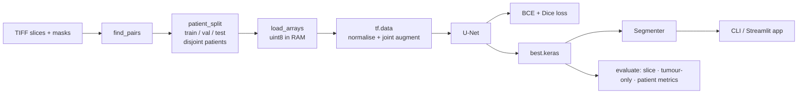

# Architecture & design decisions

## Repository layout

```
src/brainseg/        installable package (pip install -e .)
  config.py          typed dataclass config + YAML loader (rejects unknown keys)
  data.py            discovery, patient-level split, uint8 RAM cache, tf.data + augmentation
  synthetic.py       procedural brain phantoms (tests, benchmarks, demo, CI)
  model.py           build_unet(): configurable width / depth / BN / dropout
  losses.py          batch-level Dice, IoU, BCE+Dice, focal-Tversky (Keras-serialisable)
  metrics.py         hard NumPy metrics: per slice, tumour-only, per patient, FP rate
  train.py           CLI + run_training(): checkpoint, LR schedule, early stop, report
  evaluate.py        CLI + evaluate_arrays(): held-out test evaluation
  predict.py         Segmenter: any-size image -> probability map / mask / stats
  viz.py             overlays, training curves, prediction grids
  benchmark.py       latency / throughput / training speed / memory behaviour
app/streamlit_app.py interactive demo
configs/             default.yaml (real run), smoke.yaml (seconds, used by tests)
scripts/             data download, demo-model trainer, conda CUDA hook
tests/               unit · integration · e2e training · perf budgets · UI
notebooks/           legacy_colab_experiment.ipynb (archived original, outputs stripped)
```

## Data flow



## The network

Standard U-Net: an encoder of `depth` blocks (two 3×3 conv → BatchNorm → ReLU, then 2×2 max-pool,
channels doubling each level), a bottleneck, and a decoder that up-samples with 2×2 transposed
convolutions and concatenates the matching encoder feature map (skip connection). A 1×1 sigmoid
convolution (always float32, even under mixed precision) emits the per-pixel tumour probability.

| `base_filters` | depth | parameters | float32 weights |
|---|---|---|---|
| **16 (default)** | 4 | 1.95 M | 7.4 MB |
| 32 (`configs/large.yaml`) | 4 | 7.77 M | 29.6 MB |
| 64 (classic U-Net width) | 4 | 31.05 M | 118 MB |

## What changed versus the original notebooks, and why

The original project trained a 28.7 M-parameter U-Net on the Kaggle LGG dataset and reported
validation Dice ≈ 0.91 (best val-IoU 0.842). Reading the code closely turned up issues that make those numbers
unreliable, all fixed here:

| # | Original behaviour | Consequence | Fix |
|---|---|---|---|
| 1 | `trainGenerator` computed `imag, mask = adjustData(...)` but **yielded `img`** | The network trained on raw 0‑255 pixels while masks were 0/1; inference on `/255` images then gave all‑zero predictions (the “missing step” noted in the notebook) | Normalisation lives in one tf.data `prep` step; covered by a regression test |
| 2 | `train_test_split` on *slices*, unseeded | Neighbouring slices of the same patient land in train **and** test → optimistic scores, irreproducible | `patient_split` with a seed; tests assert zero patient overlap |
| 3 | The *test* set was passed as `validation_data` and used for checkpoint selection | Test metrics were selected on, i.e. not held out | Separate validation split drives checkpointing/early stopping; test is touched once |
| 4 | `dice_coefficients_loss` ignored its `smooth` argument (hard-coded default used); `jaccard_distance` was dead code | The smoothing knob silently did nothing | `smooth` honoured everywhere; BCE+Dice default for stable early gradients; losses are `register_keras_serializable` so models reload without hand-written `custom_objects` typos (the notebook's `load_model` crashed on one) |
| 5 | Hard-coded Colab/Windows paths, `!kaggle`, `lr=`/`decay=` args, `tqdm_notebook`, deprecated `epsilon=None` | Not runnable elsewhere / on current TF | YAML configs, CLI, Keras 3 API |
| 6 | Notebook cells with typos (`plt.titel`, `ressultss`, `image_file_train`), 1.2 MB of embedded outputs, two diverged copies | Fragile, bloated repo | Logic moved into a tested package; one archived notebook with outputs stripped |
| 7 | `.pyc`, TensorBoard event files, IDE settings tracked in git | Repo noise | Removed; proper `.gitignore` (data and weights are never committed) |
| 8 | No tests, no metrics beyond overall Dice/IoU | Can't tell if the model finds tumours or hallucinates them | 70+ tests; tumour-only Dice, detection recall, false-positive rate on empty slices, patient-macro Dice |

## Metrics: what they mean

About 65 % of LGG slices contain **no tumour** and the median tumour covers only ≈ 2.3 % of the
slice. Therefore a plain mean Dice (where an empty slice predicted empty scores 1.0) is flattering.
The evaluator reports several views:

* `dice`, `iou` – mean over all slices (empty‑vs‑empty = 1).
* `dice_tumor_slices` – only slices that truly contain tumour. **The headline quality number.**
* `detection_recall` – fraction of tumour slices where *something* was predicted.
* `false_positive_rate_empty` – fraction of tumour‑free slices where the model predicted tumour.
* `dice_patient_macro` – per‑patient average, so patients with many slices don't dominate.

## Testing strategy

| Layer | File(s) | What it proves |
|---|---|---|
| Unit | `test_losses`, `test_metrics`, `test_model`, `test_config`, `test_synthetic` | Math is right (known values, NumPy ↔ Keras agreement), architecture invariants (skip connections, parameter counts, gradient flow, mixed‑precision dtype, save/load exactness) |
| Data | `test_data` | Patient-disjoint split, reproducibility, normalisation regression, **image/mask stay aligned under augmentation** |
| Inference | `test_predict`, `test_cli` | Any shape/dtype/channel input → original-resolution output; CLI I/O |
| End-to-end | `test_train_e2e` (`slow`) | Synthetic dataset on disk → train → checkpoint → evaluate; model beats a trivial baseline; reloaded model reproduces test score |
| UI | `test_ui` (`ui`) | Streamlit app via headless `AppTest`: no-model guidance, controls, metrics, error handling |
| Performance | `test_perf` (`perf`) | Input-pipeline throughput, latency budget, memory budget |
| Real data | `test_realdata` (`realdata`) | Auto-skipped unless `Dataset/` exists: 3 929 pairs, 110 patients, no leakage |
